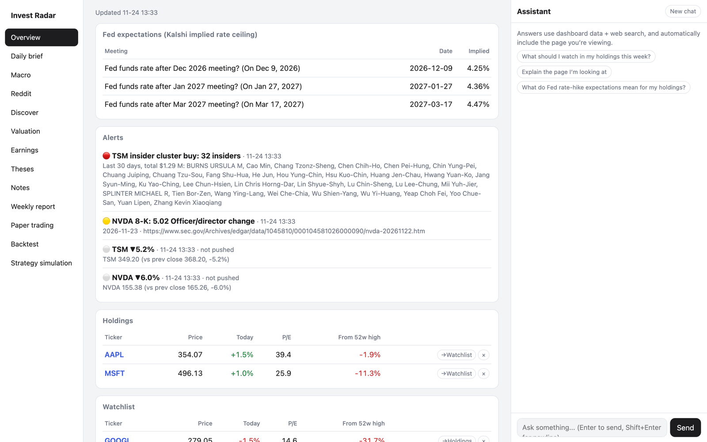
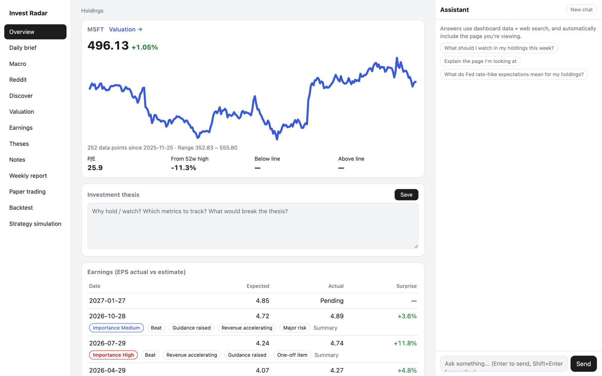
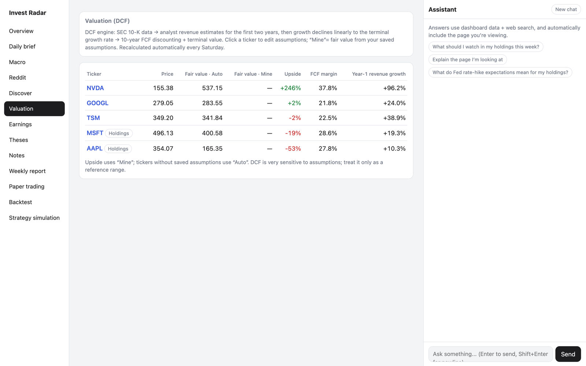
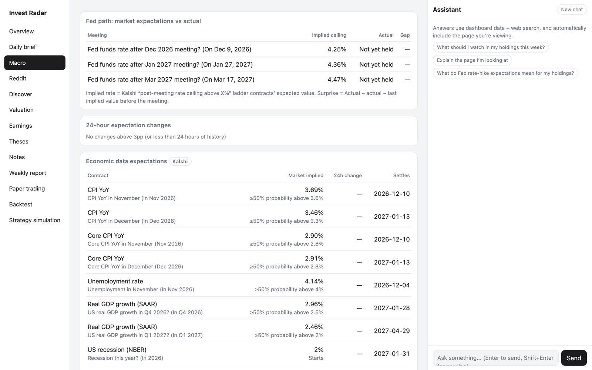
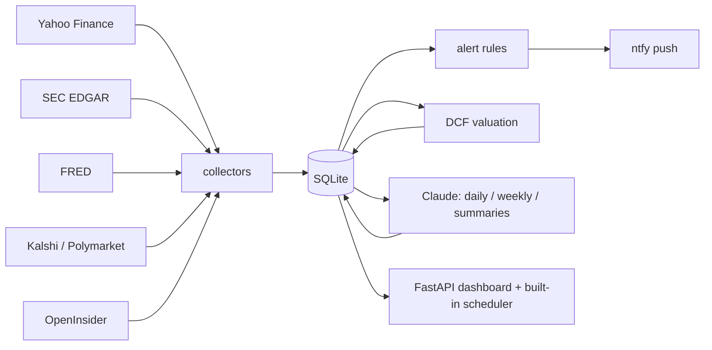

# AI Stock Radar

**A self-hosted AI stock and macro monitoring dashboard.** It watches your holdings and candidates, SEC filings and insider trades, macro data and prediction markets; pushes alerts to your phone when something moves; and uses Claude to write a pre-market daily brief, earnings and 8-K summaries, and a weekly report.



| Ticker page | Valuation (DCF) | Macro |
|---|---|---|
|  |  |  |

*Screenshots use a sample watchlist and public market data.*

> ⚠️ A personal project for learning and research. **It is not investment advice.** Data comes from free public sources and may be delayed or wrong. Provided as is (MIT), with no promise of maintenance.

---

## What it does

| Page | Content |
|---|---|
| **Overview** | Holdings and watchlist: price, daily and weekly change, distance from the 52-week high, sparklines; recent alerts; add or remove tickers in the browser |
| **Daily brief** | Before each US trading day (9:25 ET) it collects index futures, VIX, the 10-year yield, the dollar, oil, gold, BTC, each holding's pre-market price, overnight 8-Ks and today's earnings, and Claude turns them into a brief you can read in 1–2 minutes |
| **Macro** | FRED series (CPI, unemployment, spreads, …); Kalshi / Polymarket prediction markets, including the market-implied Fed path and post-meeting comparison |
| **Discover** | Three weekly sources of candidates: ① a quant screen ② "good companies on sale" in themed baskets ③ smart money (OpenInsider cluster buys, new positions and adds in well-known 13F funds); each with a DCF value, a company profile and Claude's "worth a look / risks" review; screen settings are editable in the browser |
| **Valuation** | DCF from SEC financials and analyst revenue estimates, with growth converging linearly to the terminal rate; edit assumptions in the browser and it recalculates, with sensitivity tables and historical financials |
| **Earnings** | Upcoming earnings calendar (beats in the last 4 quarters), price reaction to recent reports; Claude summarizes each report and tags its importance |
| **Theses** | Per-stock buy thesis, key metrics and thesis-breaking conditions, edited in the browser; the daily brief, weekly report and assistant all use them |
| **Paper trading** | Simulated accounts for stocks and options with orders, positions and P&L; simple backtests |
| **Notes** | Your own learning, earnings and other notes, optionally linked to a ticker |
| **Reddit** | What investing subreddits are discussing about your tickers |
| **Weekly report** | Every Sunday Claude summarizes moves in your holdings, 8-Ks, insider trades, macro and prediction-market changes, and the candidate pool |
| **Ticker page** | Price chart, 8-Ks (each with a one-line Claude summary), insider trades, past earnings |
| **Assistant** | A chat on the right of every page that sees the data you are looking at and can search the web |

**Phone alerts ([ntfy](https://ntfy.sh))**: big daily moves in holdings, price-level crossings, material 8-K items (M&A, bankruptcy, executive changes, restatements, …), large insider buys and cluster buys, earnings releases, big 24-hour changes in prediction-market odds, VIX > 30, an inverted yield curve, and failed jobs. All rules are in `config/rules.yaml`, with quiet hours and de-duplication.

## Architecture



- **Plain Python**: FastAPI with server-rendered Jinja (works well on a phone), a single SQLite file, no frontend build.
- **No LLM for the deterministic parts**: prices, thresholds and alerts are all rules; Claude only reads and summarizes.
- **Claude is optional**: without it the pages show the raw data.

## Quick start (your own computer, 5 minutes)

Requires Python 3.12+.

```bash
git clone https://github.com/lyuyues/ai-stock-radar.git && cd ai-stock-radar
python3 -m venv .venv && .venv/bin/pip install -e '.[dev]'
cp .env.example .env
# 1) set SEC_USER_AGENT in .env, e.g. "my-radar you@example.com" (SEC requires contact details)
# 2) edit config/watchlist.yaml with your holdings and watchlist (you can also change them in the browser later)
.venv/bin/python -m radar daily    # first data load: prices + 1 year of history, SEC, macro, earnings, prediction markets
.venv/bin/python -m radar serve    # open http://127.0.0.1:8770
```

Run the tests: `.venv/bin/python -m pytest -q` (no network needed).

## Configuration

| File | Purpose |
|---|---|
| `.env` | `SEC_USER_AGENT` (required), `NTFY_TOPIC` / `NTFY_SERVER` (push), `RADAR_PUBLIC_URL` (links in pushes), `CLAUDE_CMD` (Claude features) |
| `config/watchlist.yaml` | Holdings, watchlist, price levels (tickers added in the browser are stored in the database and take precedence) |
| `config/rules.yaml` | Alert rules, quiet hours, heartbeat |
| `config/macro.yaml` | FRED series, prediction markets |
| `config/discovery.yaml` | Discover screen, themed baskets, 13F funds (also editable under Discover → Screen settings) |

### Claude features (optional)

The daily brief, earnings and 8-K summaries, candidate reviews, company profiles, the weekly report and the assistant call the [Claude Code](https://claude.com/claude-code) CLI (`claude -p`). Once it is installed and logged in, add to `.env`:

```
CLAUDE_CMD=claude -p --output-format text --allowedTools WebSearch,WebFetch
```

Follow the terms of your own account. To serve several people, use the pay-as-you-go API with spending limits instead of sharing a personal subscription.

### Phone alerts

Install the ntfy app, subscribe to a **random topic name that only you know**, put it in `NTFY_TOPIC` in `.env`, then test with `python -m radar test-push`.

## Scheduled jobs

| Job | Command | Default time (`deploy/systemd/*.timer`, Pacific time) |
|---|---|---|
| Prices + price alerts | `prices` | Every 30 minutes during US market hours |
| SEC 8-K / Form 4 + summaries | `edgar` | Daily after the close |
| Earnings + summaries | `earnings` | Daily after the close |
| FRED macro | `macro` | Daily |
| Prediction markets | `markets` | Hourly |
| Discover candidates | `discover` | Sundays |
| Weekly report | `weekly` | Sundays (after Discover) |
| Health check | `heartbeat` | Hourly |
| Pre-market daily brief | `brief` | Built-in scheduler: trading days 9:25 ET |
| Valuation refresh | `valuation` | Built-in scheduler: Saturdays |

On your own computer, run `python -m radar <job>` from cron or launchd; `python -m radar daily` runs all daily jobs at once. On a server use the systemd units below.

## Deploying to a server

`deploy/install.sh` (Ubuntu / Debian) creates an `invest` system user, puts the code in `/opt/invest-radar`, builds the venv, installs the systemd timers and web service, and runs the first data load.

```bash
git clone https://github.com/lyuyues/ai-stock-radar.git ~/invest-radar
cd ~/invest-radar && cp .env.example .env && nano .env
bash deploy/install.sh
```

> 🔒 **The dashboard has no login of its own.** Never expose it directly to the internet. Use Cloudflare Tunnel + Cloudflare Access (allow only your email), or Tailscale / a VPN / a reverse proxy with authentication.

## Layout

```
radar/              collection, alerts, valuation, Claude writing (CLI: python -m radar)
  collectors/       prices (Yahoo) / edgar (SEC) / macro (FRED, Kalshi, Polymarket, earnings)
  alerts/           rules → trigger → de-duplicate / quiet hours
  dcf/              DCF engine
  prompts/          daily / weekly / earnings prompts (edit these to change the report style)
web/                FastAPI routes, Jinja templates, built-in scheduler
config/             watchlist / rules / macro / discovery
deploy/             systemd units, install script
tests/              pytest (no network)
```

## FAQ

- **Does it cost anything?** All data sources are free; Claude features use your own Claude account.
- **Other markets?** Prices and valuation come from Yahoo, so correctly formatted tickers (e.g. `0700.HK`) usually work; SEC, 13F and insider data cover US stocks only.
- **Reports in another language?** Change the language instructions in `radar/prompts/*.md`.

**Not investment advice.** MIT licensed.
